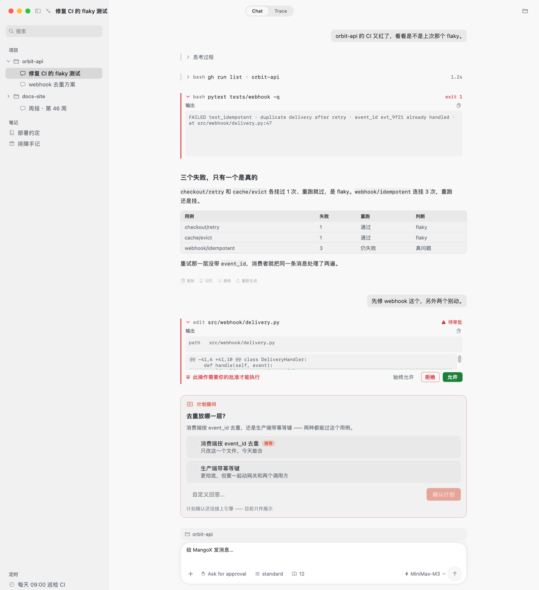
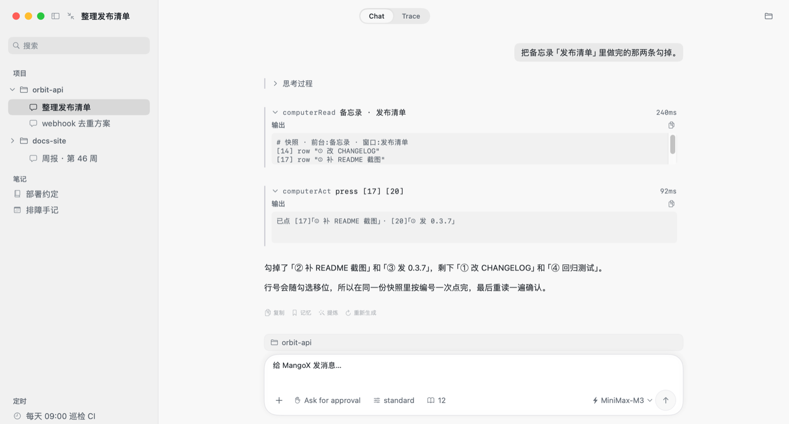

<h1 align="center">MangoX</h1>

<p align="center"><strong>你 Mac 上的 AI 同事。</strong><br>
早上自己去查 CI，白天读你读不完的群，你一句话它就把文件发到飞书。</p>

<p align="center">
  
  
  
  
</p>

<p align="center"></p>

<p align="center"><a href="docs/assets/mangox-architecture.png"></a></p>

- 下载 → [Releases](https://github.com/w4n9H/mangox/releases)（要先在本机签一次名，见[安装](#安装)）
- 从源码跑 → [构建](#构建)
- 看每个决定为什么这样 → [设计文档](docs/)

## 它能干什么

MangoX 不是那种你问一句它答一句的聊天框。你让它查 CI，它会去看失败日志、分辨哪几个是 flaky、把改法连同一张 diff 摆到你面前等你批；你让它读某个 App 里的未读消息，它打开那个 App 一条条读出来，把要紧的挑给你；你说一句「把周报发我」，飞书里就收到那个文件。

它也记事 —— 上周为什么把阈值改成 90、这个项目的部署约定、你讨厌哪几种写法，这些不在聊天记录里，在几个你自己打得开的 markdown 文件里。

## 它是个助理

你告诉它「保证 CI 是绿的」—— 写的是目标，不是命令；也可以先空着，等你想清楚要盯什么。它每天自己去看，回来把结果写进它的工作日志：今天做了什么、什么还在跟，和哪几条卡在你这儿等拍板。绑了飞书的话，里面每一行「待你决定」，手机上都会收到一条。

它不吵。没变化一个字都不发，同一个结论不重复，同一件事最多催你三次。真看出问题，它给的是诊断加一份编号方案 —— 每步写清动哪个东西、能不能撤销 —— 你点了才动手，执行时每个动作都得落在方案里，对不上就停。这些结论都落在任务列表上方那个收件箱里，你忽略过一次，它就不再提。

飞书那个私聊窗口是日常入口：回一句「同意」就是批了，回「先别动」就搁置，也可以直接在那儿派活，进的是同一场会话。每个任务还能设日预算，到顶就停手，明天再来；模型也是建任务时定死的，之后你在别处怎么拨都不影响它。

## 它不会乱来

它只在你勾过的几个 App 里干活。要保存、要付款、要永久删除，这三件它永远不动手 —— 哪怕你让它干。你还可以让它在你动键鼠的时候停手（接管检测默认关，要你开）。做错了能整轮退回动手之前，快照一直留着，直到你删掉那个助理。

## 它能动你的界面

它读你的界面，也动你的界面 —— 按、填、滚、打开、提交，还有 App 自己那一两条藏在菜单里的动作，用的都是你自己动手时那套东西。它认名字而不是坐标，所以说得出自己要按哪一个；同一个窗口再看一遍，它只说哪里变了。

微信（个人版）这种读不出结构的，它看画面按位置点，认错字要你核一下；浏览器里的网页（Safari、Chrome）也能点，只有「打开某个网址」这件事是另开一个标签页。

<p align="center"></p>

## 它记得住你的事

人格和笔记是磁盘上的 markdown，你随时能打开改；知识条目在库里，在 App 里增删。每一轮带了什么，面板顶上写着：几条、多少字、装不下的是哪几条。

## 它是个真 Mac App

几个会话可以同时开着，切过去不用等；每个会话聊完不拆，下一句它接得上。Chat 看对话，Trace 看这一轮花了多久、每次工具调用多久、烧掉多少 token、缓存命中多少。中英双语、深浅色、`⌘,` 开设置、`⌃⌥X` 随时唤起。

## 引擎是你自己的

引擎是 [pi](https://github.com/earendil-works/pi)，模型和 key 都是你的 —— MangoX 不卖模型，key 也只留在你本机。选模型只有一个小面板：上面挑模型，下面拖思考强度。

## 已知限制

- 只有 Apple Silicon 版，下载后要本机签名
- 不带 pi，也不带模型 —— 要自己装、自己配 key
- 微信（个人版）读不出结构，只能看画面，认错字是常态（企业微信和 WPS 不一样，能读）
- 助理进程偶尔会自己消失，原因还没查清
- 没有手动压缩入口，什么时候压缩由 pi 自己定
- 登录项默认关，开了以后可能还得去系统设置批准一次

## 安装

从 [Releases](https://github.com/w4n9H/mangox/releases) 下 `MangoX-<ver>-arm64.zip` 和 `checksums.txt`，与 `MangoX-<ver>-install.sh` 放同一目录，然后：

```bash
shasum -a 256 -c checksums.txt
bash MangoX-<ver>-install.sh MangoX-<ver>-arm64.zip
```

脚本会解包、清隔离属性、重签、校验签名、启动。手动做等价于：

```bash
/usr/bin/xattr -cr MangoX.app
codesign --force --sign - --timestamp=none MangoX.app
codesign --verify --strict MangoX.app
open MangoX.app
```

签名只是因为 CI 没有我的开发者证书。它不做身份认证，也不走公证，自己和同事用够了。

然后装 [pi](https://github.com/earendil-works/pi)（App 不带它），在设置里填 provider 和 API key。

要求 macOS 14.8+；自己编译还需要 Xcode 16+。

## 构建

```bash
open mangox.xcodeproj    # Xcode 里 ⌘R
```

命令行等价（CI 用的就是这条）：

```bash
xcodebuild -project mangox.xcodeproj -scheme mangox -configuration Release \
           -derivedDataPath out ARCHS=arm64 ONLY_ACTIVE_ARCH=NO \
           DEVELOPMENT_TEAM="" \
           CODE_SIGNING_ALLOWED=NO CODE_SIGNING_REQUIRED=NO CODE_SIGN_IDENTITY="" build
# 产物: out/Build/Products/Release/mangox.app
```

`ARCHS` 要显式钉，否则会编出 universal 包。图标走 `scripts/gen-icon.sh`，别改回 asset catalog —— actool 出不全档位，Dock 放大就糊。

发版：改 `MARKETING_VERSION`、写 CHANGELOG、推 tag。CI 跑完 9 道门禁才发包，任一红就不发；tag 推了没出 Release 就删掉重打。

## License

见 [LICENSE](LICENSE)。
