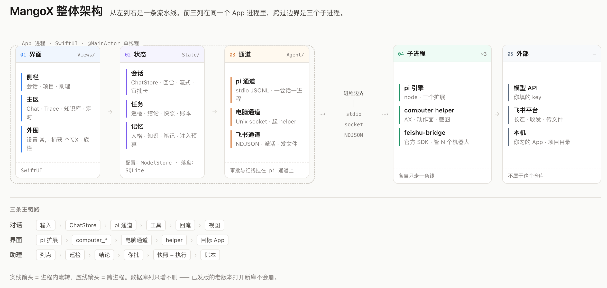

<h1 align="center">MangoX</h1>

<p align="center"><strong>你 Mac 上的 AI 同事 —— 一个会自己去看、按你划的边界动手的长期助理。</strong><br>
不是聊天框。你说「保证 CI 是绿的」，它每天自己去看，回来告诉你哪儿坏了、怎么修，<b>等你点头再动手</b>。</p>

<p align="center">
  
  
  
  
</p>

<p align="center"></p>

> **开始之前，有三件事得先对得上**（都是硬条件，不是 bug）
> 1. **引擎要你自己装** —— MangoX 不带模型、不带 key，引擎是 [pi](https://github.com/earendil-works/pi)。模型和 key 永远只在你本机。
> 2. **下载后要在本机签一次名** —— CI 没有开发者证书，包是未签名的。
> 3. **只有 Apple Silicon 版**，要 macOS 14.8+。
>
> 这三条缺一条，装上也跑不起来 —— 写在最前面，省得你白折腾一趟。

- 下载 → [Releases](https://github.com/w4n9H/mangox/releases) · 怎么装 → [安装](#安装)
- 想自己编 → [构建](#构建) · 想知道每个决定为什么这样 → [设计文档](docs/)

---

## 它替你盯的那件事

周一早上，你在地铁上。它已经跑完一轮了：

| 时刻 | 它做了什么 |
|---|---|
| **08:02** | 去 CI 跑完了这周 47 个任务，发现 3 个失败 |
| **08:02** | 挨个翻日志，分出 2 个是真坏了、1 个是 flaky（上周也红过一次） |
| **08:03** | 飞书推来一条：**「CI 有 2 个真失败 · 待你决定」**，附一份编号方案——改哪几个文件、每步能不能撤 |
| **08:41** | 你在地铁上回了一句「**同意**」 |
| **08:41** | 它开始改：动手前存快照，每个动作都得落在你批过的那几步上，对不上就停 |
| **08:47** | 它回报结果。改坏了的话，整轮能退回 08:41 之前 |

**这中间你只说了两句话。** 它没等你提醒，也没在你盯着的时候才干活。

**它记着上次为什么把阈值改成 90** —— 这不在聊天记录里，在你自己打得开的 markdown 文件里。

---

## 它也能带着几个人一起干

一个目标下面常常有几条互不依赖的活。这时候它不必自己排一条队：

| | |
|---|---|
| **一个助理可以是「管理」也可以是「执行」** | 管理助理自己按班次跑，还能派人；执行助理只有一种开始方式 —— 被派活叫起来 |
| **派活要写清两件事** | 目标，以及**怎么算干完**。这两样含糊，它就只是在替你制造两份半成品 |
| **派出去了就并行** | 两边各用自己的上下文和模型，互不排队；下属干完写一句结论，App 把它叫醒汇总 |
| **有配额，也有上限** | 一轮最多派 2 条、一天 5 条、同时最多 3 个在跑、一支队伍最多 12 个人。不做三级 —— 执行助理不能再有下属 |
| **有个「团队」页** | 五条泳道摆着谁在跑、谁排上了、谁交了活还没回话；每支队伍一个颜色，卡片左边那道竖条和左栏的圆点是同一支 |

**执行助理不能对外说话、不能互相派活、也没有自己的定时** —— 它只有一种开始方式：被叫。这是刻意的：**能自己开工的副本会失控，能被人叫醒的不会。**

---

## 它凭什么可以信

一个会自己动手的东西，你第一问的不是它多强，是**它会不会乱来**。MangoX 的答案写在代码里，不是写在话术里。

**它动界面的时候 —— 三个按钮它不替你点**

| | |
|---|---|
| **「要保存吗」它一律给你按取消** | 不替你决定丢不丢未存盘的东西 |
| **「确认付款」和「永久删除」它直接拒** | 不是"先问你"，是压根不碰 —— 写死的，不是提示词里的请求 |
| **它只在你勾过的几个 App 里干活** | 别的 App 连读都不读 |

**它改东西的时候 —— 边界在人这一侧，两级**

| | |
|---|---|
| **日常的活它直接做，不烦你** | 在助理任务里，读文件、改普通文件、跑脚本都不问 ——「改个文件也要问一次」不是保护，是噪音 |
| **要动重要的，先给方案再问人** | 方案是一串编号步骤，每步写清动什么、能不能撤；你点「采纳并执行」它才起手 |
| **重要操作在方案里单独列出来** | 删 / 覆盖重要内容 / 重启服务 / 动数据库 / 对外发消息 / 花钱 |
| **它动的不在你批的那几步上，它会停** | 跑偏即停，本轮判失败 |
| **做错了能整轮退回动手之前** | 快照一直留着，直到你删掉那个助理 |
| **它动键鼠时可以给你让路** | 接管检测（默认关，要你开） |

**自主性越高，边界越值钱。** 这两件事是一起做的 —— 不是先让它能干，再补一层安全。

---

## 它记着的事，在你看得见的地方

- **人格和笔记就是磁盘上的 markdown**，随时能打开改 —— 全局一份，项目一份，归属由位置决定
- **它每轮做了什么**，自己写进工作日志：今天完成了什么、什么还在跟、哪几条卡在你这儿
- **它往飞书发过什么**，配置页里能翻到最近五条 —— 不用翻聊天记录对账
- **它记得自己发过什么**，下一轮不会对着空气说「我昨天告诉你了」

**它不是要把你的东西收进数据库。** 那是它自己的一份账本，你的还是你的。

---

## 它能真的动你的界面

它读你的界面，也动你的界面 —— 按、填、滚、打开、提交。

**它认名字，不认坐标** —— 所以它说得出来自己要按哪一个；同一个窗口再看一遍，它只说哪里变了，不重发一整页给你。

<p align="center"></p>

少数 App 读不出结构（微信个人版），它就看着画面按位置点 —— **这时候认错字是常态，得你核一下**。浏览器里的网页也能点，只有「打开某个网址」是另开一个标签页，不能替换当前页。

**要用的能力分三档独立授权**：能读它的界面 / 能动它 / 能看截图 —— 三个勾是三件事，勾了「可读」不代表它能点。

---

## 谁适合，谁不适合

**挺适合：**

- 一个人管着好几件**要长期盯着**的事 —— CI、监控、发布、某个第三方后台
- 愿意给它划边界，但**不想天天盯着它** —— 边界给一次，它自己跑
- 想让 agent **真能用你电脑里那个 App** —— 不是网页版、不是 API，就是那个 App

**大概不太适合：**

- 想要**开箱即用**的聊天框 —— 引擎、模型、key 都得自己配
- 主要用 **Windows** —— 没有 Windows 版
- 想要**多人共享**一个助理 —— 现在是单人工具，账号共享那套还没做

---

## 装完的第一分钟

1. 装 [pi](https://github.com/earendil-works/pi)（App 不带它）
2. MangoX 设置里填 provider 和 API key —— 顺便选个模型、拖一下思考强度
3. 新建一个助理，**写目标不写命令**：
   - ✅「保证 CI 是绿的」
   - ❌「每次跑 `make test` 然后看结果」
4. 点「立即运行」，看它第一轮给你什么
5. 想让它主动找你，绑一个飞书机器人；不想，就看 App 里的收件箱

**它是按天转的，不是按分钟。** 第一天不用调参数，第二天早上看它给你什么。

---

## 安装

从 [Releases](https://github.com/w4n9H/mangox/releases) 下 `MangoX-<ver>-arm64.zip` 和 `checksums.txt`，与 `MangoX-<ver>-install.sh` 放同一目录，然后：

```bash
shasum -a 256 -c checksums.txt
bash MangoX-<ver>-install.sh MangoX-<ver>-arm64.zip
```

脚本会解包、清隔离属性、重签、校验签名、启动。手动做等价于：

```bash
/usr/bin/xattr -cr MangoX.app
codesign --force --sign - --timestamp=none MangoX.app
codesign --verify --strict MangoX.app
open MangoX.app
```

签名只是因为 CI 没有我的开发者证书。它不做身份认证，也不走公证，自己和同事用够了。

然后装 [pi](https://github.com/earendil-works/pi)（App 不带它），在设置里填 provider 和 API key。

要求 macOS 14.8+；自己编译还需要 Xcode 16+。

---

## 已知限制

**装之前就该知道的：**

- 只有 Apple Silicon 版，下载后要本机签名
- 不带 pi，也不带模型 —— 要自己装、自己配 key
- 登录项默认关，开了以后可能还得去系统设置批准一次

**用着会撞到的：**

- 微信（个人版）读不出结构，只能看画面，认错字是常态（企业微信和 WPS 不一样，能读）
- 助理进程偶尔会自己消失，原因还没查清
- 「已发消息」只记它自己说的话，不含 App 的系统提示；这一版之前发过的没有记录
- 没有手动压缩入口，什么时候压缩由 pi 自己定
- 英文界面缺项会回落成中文 key（不报错），词表对账在 `gen_strings.py --check`
- **「团队」页是看板不是编辑器**：点一张卡只能跳回定时任务页去改。存量助理一律算管理助理，想用队伍得新建一个执行助理
- **执行助理没有定时、没有飞书入口、不发通知** —— 它只被派活叫起来，也只写台账和回执
- **只有最近一轮的 html 预览是真渲染的**：往上翻到的历史轮次只留一行「文件名 + 预览」，点开才是放大窗。对话里同时挂很多个网页会让滚动变卡、内部滚动位置乱跳，所以整场对话只留一个活着的预览
- **分享图里的网页只截首屏**（约一屏高）：长页面不会整页截进去 —— 那会把分享图变成一张超长图，缩到屏宽后什么都看不清。要完整内容请直接分享文件本身
- **每装一版要输一次登录密码**（钥匙串授权）：凭据都在同一个条目里，所以只问一次；从 0.3.8 升上来的**第一次**要问四五次，那是把老条目搬进新条目，之后不会再有。签名是本机临时签的，所以每装一版还得再点一次「始终允许」

**更细的取舍**（为什么这么定、哪些是「有意」不做）→ [设计文档](docs/)

---

## 细节

- **它是个真 Mac App** —— 几个会话可以同时开着，切过去不用等；每个会话聊完不拆，下一句它接得上
- **Chat 看对话，Trace 看这一轮花了多久** —— 每次工具调用多久、烧掉多少 token、缓存命中多少
- **它写完的报告当场就在对话里** —— 这一轮生成或改了 `.html`，回复下面直接出预览卡，不用去工作区找文件；一轮改了好几份就预览最后改的那份
- **分享出去也带着那一页** —— 「分享」把它存成图片进剪贴板，网页预览会作为首屏截图一起画进图里（太长放不下时降级成一行文件名）
- **约下的事也能撤** —— 它判断某件事已经结束了，可以自己作废那条「约好某天再看」；你在飞书上说一句也算
- **`⌃⌥X`** 随时唤起，把一句话扔进某场会话
- 中英双语，深浅色，`⌘,` 开设置

---

## 引擎是你自己的

引擎是 [pi](https://github.com/earendil-works/pi)（Apache-2.0），模型和 key 都是你的 —— **MangoX 不卖模型，key 也只留在你本机**。

<p align="center"><a href="docs/assets/mangox-architecture.png"></a></p>

<div align="center"><sub>界面、状态、通道在同一个 App 进程里。跨过进程边界的是：pi 引擎、computer helper、飞书桥。最右是你自己的模型 API、飞书，和你勾选过的那些 App。</sub></div>

---

## 构建

```bash
open mangox.xcodeproj    # Xcode 里 ⌘R
```

命令行等价（CI 用的就是这条）：

```bash
xcodebuild -project mangox.xcodeproj -scheme mangox -configuration Release \
           -derivedDataPath out ARCHS=arm64 ONLY_ACTIVE_ARCH=NO \
           DEVELOPMENT_TEAM="" \
           CODE_SIGNING_ALLOWED=NO CODE_SIGNING_REQUIRED=NO CODE_SIGN_IDENTITY="" build
# 产物: out/Build/Products/Release/mangox.app
```

`ARCHS` 要显式钉，否则会编出 universal 包。图标走 `scripts/gen-icon.sh`，别改回 asset catalog —— actool 出不全档位，Dock 放大就糊。

发版：改 `MARKETING_VERSION`、写 CHANGELOG、推 tag。CI 跑完 9 道门禁才发包，任一红就不发；tag 推了没出 Release 就删掉重打。

---

## License

见 [LICENSE](LICENSE)。
